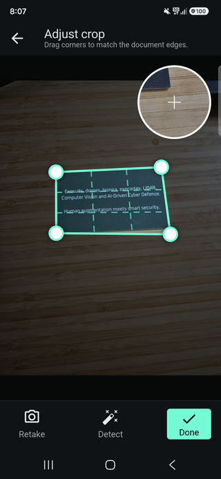

# Image cropper and magnifier

Local, unpublished AresEdge 2.1.0 candidate. Import
`package:ares_edge/ares_edge.dart`.

[](../media/editor-cropper-full.png)

Adjust the four corners to the document edges. The magnifier follows the source
image under the dragged corner and stays on the opposite side of the preview.
The shaded surroundings and dashed perspective grid help align the selection.

## Embed only the cropper

Create a controller once in your State, using JPEG/PNG bytes and the same signed
licence key used for scanning. Place the component in a bounded layout:

```dart
late final editor = AresEdgeEditorController(
  imageBytes: widget.imageBytes,
  licenceKey: const String.fromEnvironment('ARES_EDGE_LICENCE'),
  options: const AresEdgeEditorOptions(
    cropColor: Color(0xFF79FFE1),
    showMagnifier: true,
    magnifierZoom: 2.2,
    magnifierDiameter: 112,
  ),
);

// In build, inside a Column with bounded height:
Expanded(child: AresEdgeCropper(controller: editor));

// Your buttons can invoke the same session:
await editor.detectCorners(); // Animate handles; retain the full image.
await editor.applyCrop(); // Commit perspective correction.
await editor.undo();
final png = await editor.exportImage();

// In State.dispose:
editor.dispose();
```

The embedded component includes crop interaction controls. Your app chooses its
placement and any surrounding toolbar/navigation; it can add or omit the other
editing components. Share this controller with Draw, Filters, Text or Adjust when
those tools should operate on the same image. Disable host commands while
`editor.isBusy` and handle `PlatformException`.

`detectCorners()` updates the selection without replacing source pixels. If a
boundary is not found, `DOCUMENT_NOT_FOUND` preserves the image. `autoCrop()` is a
separate detect-and-extract command. Export also applies pending crop handles.
Detection is local and uses the SDK’s document detector. No network service or
AI image-generation feature is involved.

## Crop in the provided activity

Open `AresEdgeScreen.open(..., photoEditor: true)` to scan into the image editor,
or `AresEdgePhotoEditor.open(...)` for an existing image. The editor opens first;
users choose **Crop** when they want to adjust it. The activity retains the full
captured photo so the user can expand the detected selection.

- **Retake** returns to scanning when a scanner is available.
- **Detect** animates the quad and grid to the detected boundary; reduced-motion settings are respected.
- **Done** applies the perspective crop and returns to the editor.
- **Back** cancels the crop adjustment and preserves the preceding working edits.
- **Save** in the editor returns the final edited PNG to the client.

The activity layout, tool order, magnifier and navigation are SDK-owned. Its
supported UI customisation is colour codes only. Use the embedded cropper for
custom composition or component settings. The unpublished candidate’s broader
activity-option overrides are being restricted before release; see the
[integration contract](image-editor.md#choose-how-to-integrate).

`photoEditor: false` skips the editor and cropper pages but still returns a
perspective-cropped document by default. It does not mean full-camera-image
output. `extractDocument: false` is the separate explicit full-frame option.

The screenshot illustrates the AresScan+ crop interaction; SDK pages keep their
own fixed presentation. See [image editor](image-editor.md) for licence/trial,
image limits, lifecycle, save/cancel semantics and the embedded/activity split.
