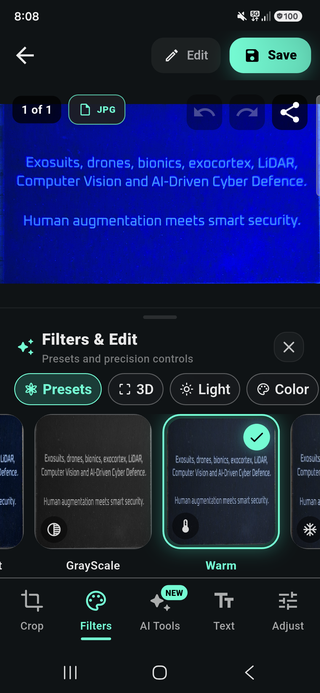
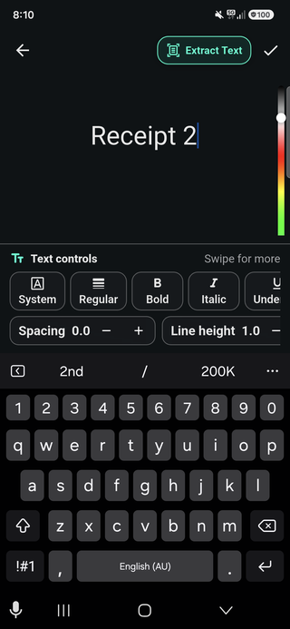

# Image editor: embedded components or activity route (2.1.3)

Available in AresEdge **2.1.3** for Android and iOS. Install `ares_edge: ^2.1.3`
to use the scanner and modular native editor.

## Choose how to integrate

| | Embedded components | Ares Defence Labs activity route |
| --- | --- | --- |
| Who builds the interface? | Your app owns layout, navigation and surrounding controls. | Ares Defence Labs provides the complete scanner/editor interface. |
| Which tools appear? | Pick any of Crop, Draw, Filters, Text and Adjust; embed only what you need. | All five tools in the SDK-defined order and layout. |
| UI customisation | Compose the widgets and connect your own buttons to a shared controller. | Colour codes only; no custom tool lists, layouts, button builders or replacement controls. |
| Navigation and output | Your app decides when to crop, export, save or cancel. | Scan → image editor → Save returns edited PNG bytes; Crop opens its separate page. |
| Skip editing | Handle the camera callback directly. | Set `photoEditor: false` to return the cropped document immediately. |

The activity accepts `AresEdgeEditorColors` only. Its tool list, order, controls,
magnifier and layout are fixed by the SDK. Embedded sessions use
`AresEdgeEditorOptions` and each component can hide its built-in footer with
`showControls: false` when the host provides its own controls.

“Activity route” means the SDK-provided Flutter page in your existing Android
Activity/iOS UIViewController, not a separately exported Android Activity class.
Using the activity does not change the AresScan+ application interface.

## Open the provided activity

```dart
final image = await AresEdgeScreen.open(
  context,
  licenceKey: const String.fromEnvironment('ARES_EDGE_LICENCE'),
  photoEditor: true, // Default; false returns the cropped document directly.
  options: const AresEdgeOptions(
    overlayColor: Color(0xFF79FFE1),
    gridColor: Color(0x66FFFFFF),
    captureTraceColor: Color(0xFFFFB74D),
  ),
  editorColors: const AresEdgeEditorColors(
    primary: Color(0xFF79FFE1),
    crop: Color(0xFF79FFE1),
    drawing: Color(0xFFFF5252),
  ),
);
```

The activity owns its toolbar, tool dock, filter picker and Save/Cancel flow.
Developers configure colour codes; end users interact with the provided tools.
For a custom tool selection or interface, use the embedded components below.

With `photoEditor: true`, the scanner retains the full captured photo and opens
the **image editor first**, with a perspective-cropped preview. The full photo
and detected corners remain in the native session. Tap **Crop** to open Adjust
crop over the original scene, so you can expand the selection beyond its detected
boundary. Imported gallery images are detected locally before the editor preview.

Drag a corner to show a magnifier on the opposite side of the preview. The area
outside the document is shaded; a dashed grid helps align the perspective.
**Detect** smoothly animates the handles and dashed grid to the new boundary
without replacing the photo. The animation respects the device’s reduced-motion
setting. **Done** applies the
perspective crop and returns to the editor. **Retake** returns to scanning without
delivering an image. Back cancels the crop adjustment and restores the current
working edits. Reopening Crop uses the retained pre-crop photo; Done replaces the
working image with that crop, while Undo can restore the previous working image.

The camera is removed while editing. Save returns edited PNG bytes to the caller;
cancelling returns to scanning. `photoEditor: false` skips all editor pages and
returns the native perspective-cropped document immediately by default. For that
direct path, `extractDocument: false` explicitly requests the full photo instead.
A null scanner result means scanner cancellation or expired access.

## Pick and choose embedded components

Create one controller in State and reuse it for the components you choose. You
can embed just a cropper, just filters, or any combination of tools. You own the
layout, navigation and Save/Cancel controls. Select components by placing widgets;
you do not need an activity or a `modes` list to compose them.

```dart
late final editor = AresEdgeEditorController(
  imageBytes: widget.imageBytes, // JPEG/PNG supplied by your application.
  licenceKey: const String.fromEnvironment('ARES_EDGE_LICENCE'),
  options: const AresEdgeEditorOptions(
    showMagnifier: true,
    magnifierZoom: 2.2,
    magnifierDiameter: 112,
  ),
);

// Place ONE of these surfaces in an Expanded/SizedBox with bounded dimensions:
AresEdgeCropper(controller: editor);
AresEdgeDrawing(controller: editor);
AresEdgeFilters(controller: editor);
AresEdgeAdjustments(controller: editor);
AresEdgeText(controller: editor);

// Hook your own controls into the same session. Await and handle each command.
await editor.setFilter(AresEdgeFilter.monochrome);
await editor.adjust(brightness: 0.1, contrast: 1.15, saturation: 1);
await editor.autoAdjust();
await editor.addText('Reviewed',
  style: const AresEdgeTextStyle(color: Colors.white, fontSize: 48,
    fontFamily: 'sans', bold: true, letterSpacing: 1, lineHeight: 1.2),
  position: const Offset(0.5, 0.8));
await editor.configureDrawing(color: Colors.orange, width: 8);
await editor.drawStroke([const Offset(0.1, 0.5), const Offset(0.9, 0.5)]);
await editor.detectCorners(); // Updates handles, preserves the full source.
// await editor.autoCrop(); // Detects and immediately extracts instead.
await editor.applyCrop();
await editor.rotate();
await editor.undo();
await editor.redo();
await editor.reset();
final png = await editor.exportImage();

// In State.dispose:
editor.dispose();
```

The embedded cropper owns draggable perspective handles, a source-aligned
magnifier, outside shading and a dashed grid. Its built-in controls provide
Apply crop, Auto detect and Undo; a host can call `detectCorners()` to update only
the selection. The ready-made activity uses the full-size Adjust crop page with
Retake, Detect and Done controls instead. Export also applies pending crop
handles. Automatic crop invokes the same local document detector as the scanner;
`DOCUMENT_NOT_FOUND` preserves the image. Automatic tonal adjustment balances
brightness/contrast without a remote or generative AI service. Drawing is
freehand; the [complete filter catalogue](filters.md) includes all 37 AresScan presets and Sepia, with strength, parameter controls and custom LUTs. Tonal controls are brightness,
contrast and saturation. Filter/tonal settings are non-destructive until a pixel
operation commits them. Undo history is bounded; its availability is reported by
`controller.canUndo` and `controller.canRedo`. Reset restores the initially decoded source.

Listen to the controller to update your own buttons. Disable them while
`isBusy`; handle `PlatformException` from commands, including `LICENCE_REQUIRED`.
A controller cannot be reused after disposal. Use a new controller for a new image
or new immutable options. Do not create a controller in build. Avoid overlapping
editing surfaces over the same pixels; use tabs or your own mode selector.

## Open the provided editor for an existing image

```dart
final edited = await AresEdgePhotoEditor.open(
  context,
  imageBytes: sourceBytes,
  licenceKey: configuredKey,
  colors: const AresEdgeEditorColors(
    crop: Color(0xFF79FFE1), drawing: Color(0xFFFF5252),
  ),
);
// edited is null on cancel/expired access, otherwise edited PNG bytes.
```

`AresEdgePhotoEditor.open` provides the same fixed five-tool activity without
opening a camera. It can also be mounted with `onComplete` in your own route;
mounting it does not turn it into a configurable tool-builder interface.
Only the five basic modes are provided. No owner CropperPage/ImageCapture classes,
AI features, video tools or legacy editor implementation are exported.

## Licensing, privacy and limits

The same signed Edge SDK licence authorizes the scanner and editor offline.
There is no separate editor licence. An Office scanner-only entitlement does
not silently authorize this standalone Edge editor. Standalone editor use shares the same
process-wide evaluation deadline. Every native command/export validates access;
an expired editor stops accepting interactions and cannot export. A session ID
is not a licence or a way to reset the trial.

Images remain on device. Inputs are limited to 32 MiB and 20 million source
pixels; decoded/editor output is limited to 8 million pixels and the requested
maximum longest side (default 2048, configurable 256–4096). EXIF orientation is
normalized before handles/drawing are mapped. Undo and redo together are limited to three snapshots
and a 32 MiB snapshot pixel budget. A new edit clears redo history. At most two native sessions may be active
per Flutter engine. Dispose sessions promptly. Native image processing/drawing
is compiled into the SDK; only the documented Dart API and integration wrappers
are readable in the customer package. Offline/on-device protection is not a
promise that binaries or image buffers cannot be inspected on a modified client.

## AresScan presentation

The ready-made scanner uses AresScan-style floating dark controls, a circular
shutter and mint outline. The editor uses a rounded tool dock and save action.
Native embedded controls use the same mint accents, rounded action buttons and
brightness/contrast/saturation tracks; stock operating-system button gradients
are not used. Crop handles have an inset so they remain visible at image edges.

Light and dark surfaces follow the nearest Flutter theme brightness. Fonts in
the Flutter page inherit the host app font; native labels use accessible system
fonts. This package does not import the owner app or its proprietary font assets.
Embedded controls reserve bottom safe-area space. Your application still owns
its route, surrounding controls and available component size.

Basic Text annotations are plain on-device text, not OCR. The native Text tool
lets users enter a caption, tap the image to position it, apply it and undo it.
`addText` accepts at most 512 UTF-16 code units, source-pixel font sizes 8–256,
an ARGB Flutter colour, and a normalized position within 0–1 on each axis.
Text is rasterized into the edited image and included in PNG export.

These activity layouts belong to the SDK only. AresScan+ application pages are
unchanged. The SDK editor shows thumbnail filter presets and a focused tool
panel, with Crop, Draw, Filters, Text and Adjust navigation. It includes no AI,
3D generation, multipage workflow or placeholder actions.

## Crop, filter and text workflows

[](../media/editor-cropper-full.png)

Drag the corners using the magnifier, run Detect to animate the detected boundary,
then Done to apply the perspective crop. See the [cropper component guide](cropper.md).

[](../media/editor-filters-full.png)

Filter previews in AresScan+. The SDK provides the same 37-preset catalogue plus
Sepia through an embedded picker or the activity’s Filters tool. AI Tools shown
in the app screenshot are not included. See [all filters and controls](filters.md).

[](../media/editor-text-full.png)

The Text component provides portable system/sans/serif/monospace families,
bold, italic, underline, left/centre/right alignment, colour, font size,
letter spacing and line height. The same controls are available in the activity.
OCR/Extract Text shown in the AresScan+ reference remains an app-only feature.
Text is rasterized when applied; Undo/Redo restores or reapplies the annotation.

For a custom text interface, embed `AresEdgeText(controller: editor)` and connect
host-owned controls to `editor.addText(...)`. The activity provides its own Text
tool; developers customise its colours rather than replacing that interface.

## Palette and host-owned controls

`AresEdgeEditorColors` exposes `primary`, `onPrimary`, `surface`, `card`, `panel`,
`foreground`, `outline`, `crop`, `drawing` and `annotation`. Null roles use the SDK
light/dark defaults. The activity accepts this palette without accepting custom
layouts or tool lists. Camera overlay colours remain in `AresEdgeOptions`.

For a custom toolbar, set `showControls: false` on an embedded component. The canvas
still handles crop dragging/magnification, freehand drawing and text placement.
Use `setCropCorners`/`resetCrop`, `configureDrawing`/`drawStroke`, `addText`,
`setFilter`, `adjust` or `applyColorMatrix` from host controls. `load()` initializes
a headless session; `imageSize` and `cropCorners` expose its current geometry.
A colour matrix has twenty row-major Flutter 4×5 entries; offsets are in 0–255
channel units. Every operation stays subject to native licence checks.

`compositeImage(bytes, destination: normalizedRect)` commits a host-rendered
transparent PNG overlay with source-over alpha and clipping. It lets existing
text, drawing or sticker interfaces keep custom fonts and authoring controls
while the SDK handles composition, native licence enforcement and undo/redo.
