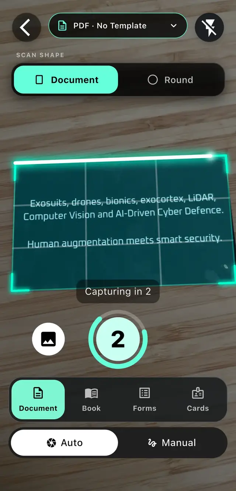
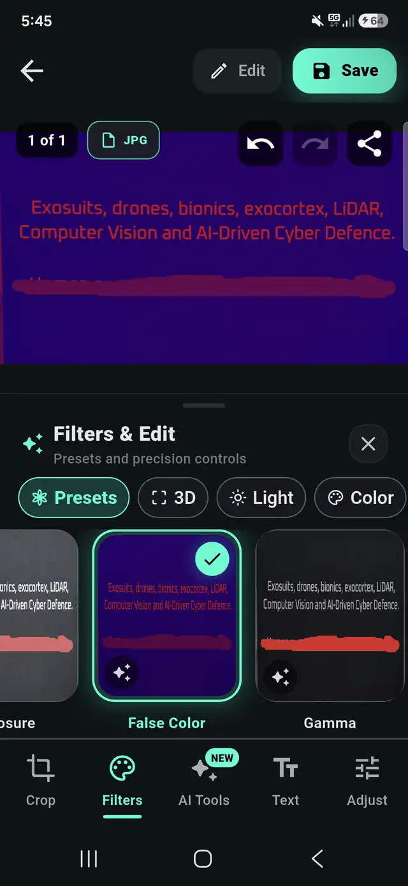
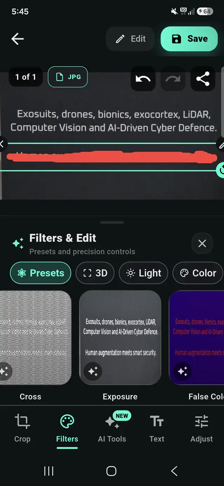

# Visual demos

## Watch

- [AresScan+ demo](https://www.youtube.com/watch?v=au0fnn8yGHE).
- [Official AresScan+ trailer](https://www.youtube.com/watch?v=QoQ2w-9bvho).
- [Official AresScan walkthrough page](https://aresdefencelabs.com/ares-scan).

The video IDs match those configured in the official website source. The app
walkthroughs show how scanning and editing fit into AresScan. GitHub opens the
videos externally; embedded video playback is available on the official page.

## Document boundary detection

The document outline and capture countdown are visible in the AresScan scanner.
This is the host app's complete scanning screen. For your own toolbar, use
AresEdgeEmbedded. For the SDK's minimal toolbar, use AresEdgeScreen.

## Filters and adjustments

| Filter controls in the app | Adjustment workflow in the app |
| --- | --- |
|  |  |

These unmodified screenshots are from the official AresScan page's local assets.
AresScan includes additional application features, such as AI tools and document
formats. The commercial AresEdge SDK's lightweight editor is limited to the
features in the [public API guide](scanner-screen.md). Screenshots are not a
pixel-for-pixel promise of AresEdgeScreen's UI and contain no benchmark results.

## Try and measure

Install [AresScan+](https://aresdefencelabs.com/ares-scan) to try the app, or run the
[example project](../example/README.md) to try the actual public SDK widgets.
Use the [performance workbench](performance-testing.md) to collect measurements
from your hardware; no performance scores are fabricated or pre-populated.
